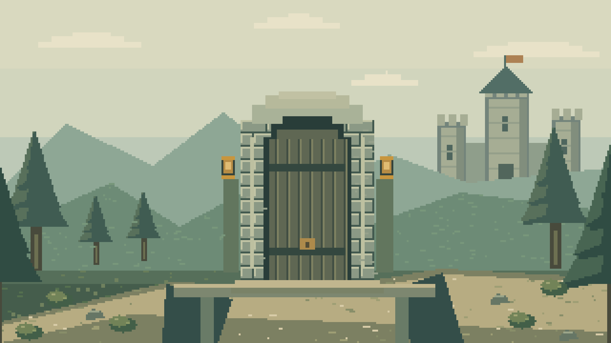

# Keybreakers: The Goblin’s Gate



**Keybreakers** is a calm, home-network math adventure for an 8–9-year-old builder and a parent at the table. Guided by **Rivet the clockwork owl**, your child works through four mathematical puzzles on the road to the Castle of Theorems using George Pólya’s four stages—**Understand**, **Plan**, **Carry Out**, and **Look Back**—discovering a named idea and earning its **Golden Seal** at every gate.

There are **no timers, no scores, no streaks, and no leaderboards**—ever.

Each challenge opens with one note box for an idea, working, or a question. There is no readiness click or separate answer-and-reason form. Enter adds a line; Send note or Ctrl/Command+Enter sends it to Rivet.

You speak as the boy Keybreaker; Rivet is your owl guide. Story buttons change the pictured speaker and the named speech bubble. In the Dark Vault, The chest introduces the puzzle, The rules explains how to play, and This torch shows the current goal. Find the smallest number that always works, keep drawn crystals out, and start each torch with a full chest.

**Presentation:** one cloud-edged map, a boy Keybreaker at the start, and four challenge landmarks. Each encounter brings the story and dialogue into one scene. Lemma’s creature deck, an optional calculator, calculation tape and scratchpad support the child’s own work. Speech bubbles unfold silently, with Read now / Read again and a saved instant-speech setting. Words stay available and never hold up play. The open conversation history keeps messages from the current play visible. Starting again from the map clears the conversation and working tools; reloading resumes the current play. Children can state an answer in chat and explain how they found it; the game checks it deterministically, credits any complete toll-route verification already supplied, and asks for a separate final check only when it is still needed. The series title is provisional; see [name screen](docs/NAME-CHECK.md). [Cast concept](docs/art/keybreakers-cast-concept.png) · [Pixel style bible](tools/assets/style.md).

---

## Play at Home in Three Commands

Requires **Node.js 20.12+ or 22+** on your laptop (no `npm install` packages are needed—the game has zero external dependencies).

```bash
# 1. Optional: copy .env.example to .env if you want live AI tutoring or a custom Parent PIN
cp .env.example .env

# 2. Start the server on port 8080 across your home Wi-Fi (works offline out of the box)
PORT=8080 node --import ./server/load-env.js -e "import('./server/index.js').then(m => m.startServer(8080, '0.0.0.0').then(() => console.log('Ready on port 8080')))"

# 3. Open the game in Safari or Chrome (or visit http://<your-laptop-ip>:8080 on an iPad)
open http://localhost:8080
```

> **Quick localhost shortcut:** If you are playing on the same laptop and do not need iPad LAN access, `PORT=8080 npm start` starts the server on `http://127.0.0.1:8080` and loads `.env` automatically.

---

## Rivet through agy

With the Antigravity CLI already installed and signed in, set these values in your local `.env`, then restart with `npm start`:

```dotenv
TUTOR_ADAPTER=agy
AGY_MODEL=gemini-3.8-flash-low
AGY_EFFORT=low
AGY_TIMEOUT_MS=30000
```

The CLI retains its own local conversation history under its normal account settings. This uses your authenticated agy account; it does not need a Gemini API key. Each turn runs in a fresh temporary workspace with tool use denied, strict output parsing and the same Socratic leak gate. The CLI has a longer startup allowance than the direct REST adapters. A failed, unsafe or slow reply falls back to the offline tutor. The parent dashboard shows the configured model and the source of the latest reply. `TUTOR_ADAPTER=scripted` keeps the whole game playable offline.

## For the Parent at the Table

Open **`http://localhost:8080/parent`** (or `http://<your-laptop-ip>:8080/parent`) in your browser and enter the 4-digit PIN (default **`1234`**, configurable via `PARENT_PIN` in `.env`):

- **Live Transcript:** Watch every child action, current Pólya stage, hint rung (`l0` → `l1` → `l2` → `l4` → `l3`), and tutor reply in real time.
- **Scribe Mode:** Toggle Scribe Mode so you can type what your child says out loud while your child keeps tapping chips and manipulating diagrams on the iPad.
- **Nudge Hint Rung:** Manually adjust the hint ladder level for the next turn if your child needs a gentler or more concrete nudge.
- **Waive Look Back:** Once per chapter, award the Golden Seal directly if your child has already explained the idea aloud and is ready to rest.
- **Dyslexia-Friendly Font:** Toggle OpenDyslexic-style accessible spacing and typography across the interface.

---

## Chapter 1 Encounters

| Node | Encounter | Interactive Mechanic | Idea Named at the Golden Seal |
| :--- | :--- | :--- | :--- |
| **1** | **Chasm of Reverse Tolls** | `inverse-chain` (undo gate operations right-to-left) | Inverse operations — *"The Socks-and-Shoes Rule"* |
| **2** | **The Alchemist’s Dark Vault** | `goblin-bins` (play the worst-case goblin across parts a, b, c) | Pigeonhole principle — *"The Goblin Rule"* |
| **3** | **Courtyard of Five Shields** | `seam-grid` (shared-seam unit ratios & perimeter walk) | Shared edges cancel — *"The Hidden Seams Rule"* |
| **4** | **Castle Keep Portcullis** | `factor-dials` (prime factor trees & shared guardian rune) | Unique prime factorisation — *"The Rune Splitting Rule"* |

---

## Repository Documentation Map

If you are picking up this project from another machine, account, or coding agent session, start here:

- **[SPEC.md](SPEC.md)** — Authoritative v1 design & engineering specification (10 design pillars, Pólya state machine, visibility matrix, 8-stage leak gate, Chapter 1 math content, eval thresholds, and §15 product-later seams).
- **[AGENTS.md](AGENTS.md)** — Standing engineering rules, invariants, non-negotiable guardrails, and verification commands for AI coding agents and contributors.
- **[docs/ARCHITECTURE.md](docs/ARCHITECTURE.md)** — Complete file-by-file codebase reference, module interfaces, HTTP/SSE wire contracts, SVG diagram architecture, test inventory, and spec-vs-implementation notes.
- **[docs/HANDOFF.md](docs/HANDOFF.md)** — Continuation guide for picking up work from another account: current build state and saved test evidence, operational nuances, live Gemini/Claude configuration, pixel art review and visual playtesting, and authoring Chapter 2+.
- **[TEST_READY.md](TEST_READY.md)** — 46-feature coverage table and 5-tier verification suite manifest.
